<a href="https://moreblessing-maposa.vercel.app">
<picture>
  <source media="(prefers-color-scheme: dark)" srcset="assets/hero-dark.svg">
  <source media="(prefers-color-scheme: light)" srcset="assets/hero-light.svg">
  
</picture>
</a>

  
  
  

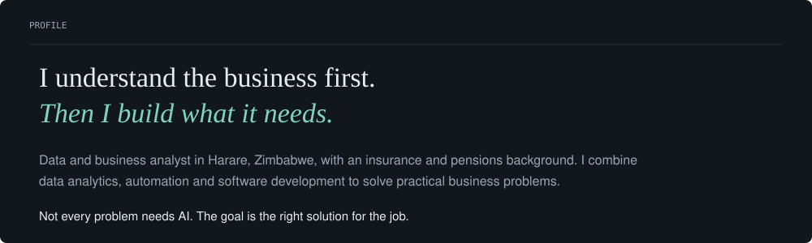


  <a href="https://github.com/moreblessing-maposa/case-studies/tree/main/query-hub">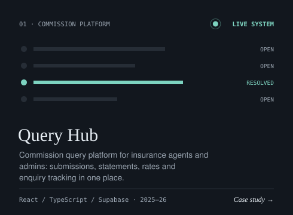</a>
  <a href="https://github.com/moreblessing-maposa/case-studies/tree/main/automated-underwriting"></a>

  <a href="https://github.com/moreblessing-maposa/case-studies/tree/main/commission-statement-automation">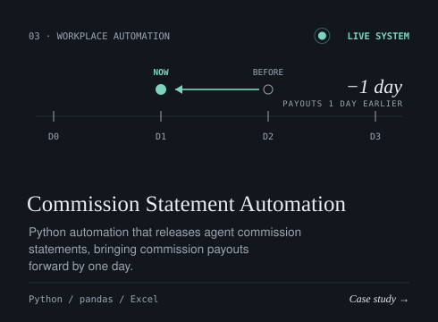</a>
  <a href="https://github.com/moreblessing-maposa/case-studies/tree/main/metalos"></a>

  <a href="https://github.com/moreblessing-maposa/case-studies/tree/main/grillos"></a>
  <a href="https://github.com/moreblessing-maposa/case-studies/tree/main/car-wash-os">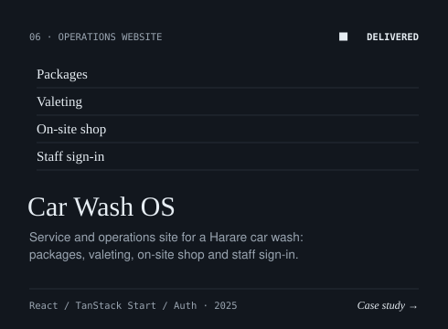</a>

<a href="https://moreblessing-maposa.vercel.app">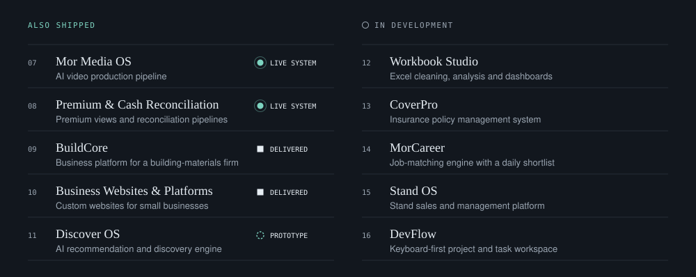</a>

  <a href="https://github.com/moreblessing-maposa/Bulk-Excel-Export-Tool"></a>
  <a href="https://github.com/moreblessing-maposa/VBA-Merge-Workbooks"></a>
  


  Open to remote roles and consulting. Through <b>MorTech</b>, my consulting practice, I take on selective part-time work in analytics, business analysis, automation and business systems.

  
  
  

<a href="https://moreblessing-maposa.vercel.app"></a>
