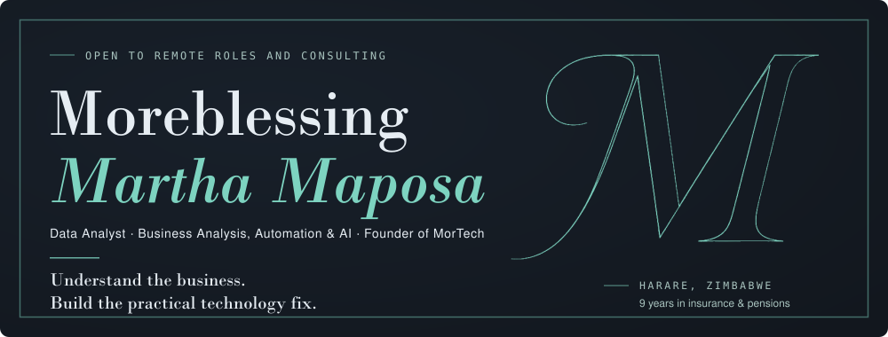
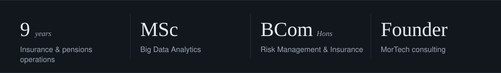
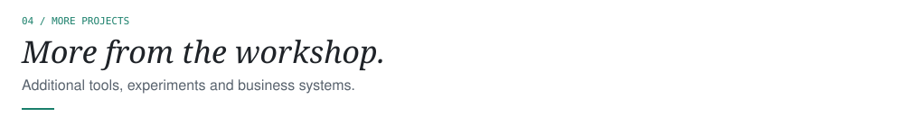
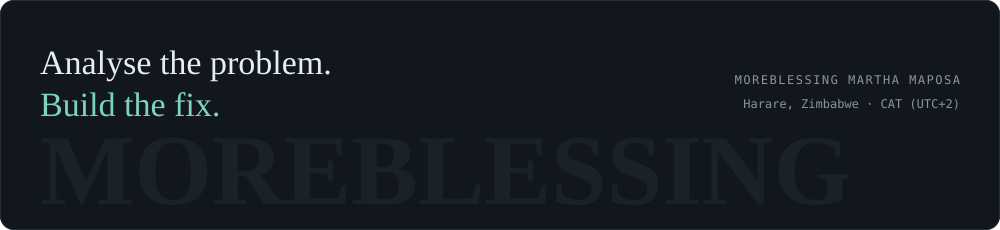

  
  
  

 

<picture>
  <source media="(prefers-color-scheme: dark)" srcset="assets/title-1-dark.svg">
  
</picture>

 

<picture>
  <source media="(prefers-color-scheme: dark)" srcset="assets/title-2-dark.svg">
  
</picture>

 

<picture>
  <source media="(prefers-color-scheme: dark)" srcset="assets/title-3-dark.svg">
  
</picture>

  
  

  
  

  
  

 

<picture>
  <source media="(prefers-color-scheme: dark)" srcset="assets/title-4-dark.svg">
  
</picture>

 

<picture>
  <source media="(prefers-color-scheme: dark)" srcset="assets/title-5-dark.svg">
  
</picture>

  
  
  

 

<picture>
  <source media="(prefers-color-scheme: dark)" srcset="assets/title-6-dark.svg">
  
</picture>

 

<picture>
  <source media="(prefers-color-scheme: dark)" srcset="assets/title-7-dark.svg">
  
</picture>

Open to remote roles and consulting. Through **MorTech**, my consulting practice, I take on selective part-time work in analytics, business analysis, automation and business systems.

  
  
  

 

<picture>
  <source media="(prefers-color-scheme: dark)" srcset="assets/footer-dark.svg">
  <source media="(prefers-color-scheme: light)" srcset="assets/footer-light.svg">
  
</picture>
